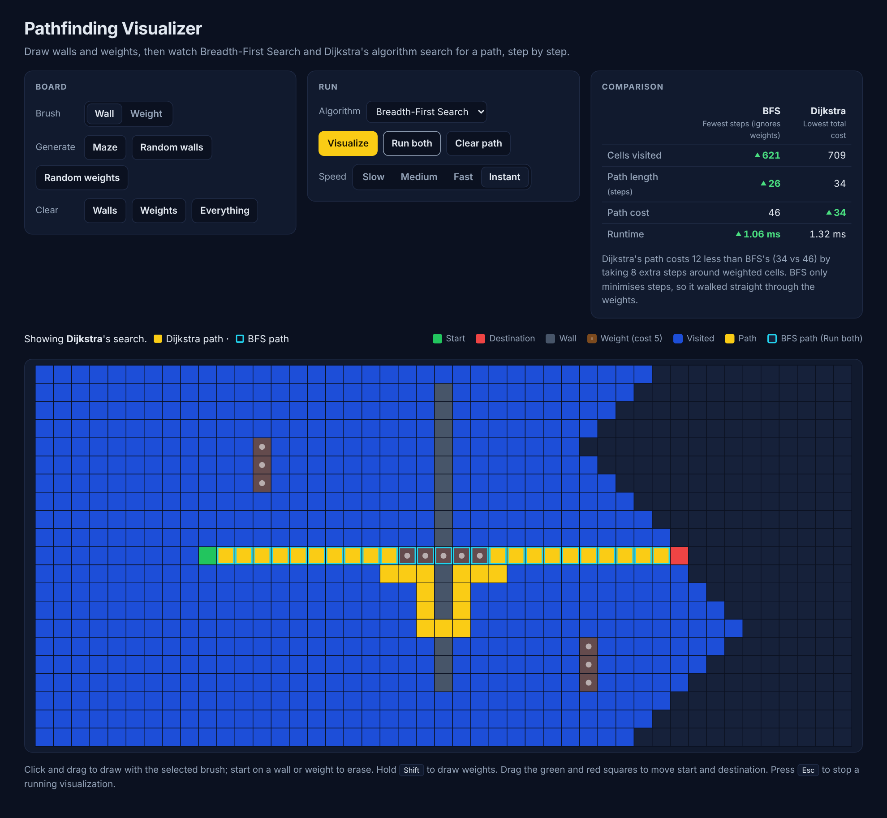

# Pathfinding Visualizer

An interactive grid where you draw walls and weighted cells, then watch **Breadth-First Search** and **Dijkstra's algorithm** search for a path, step by step, and compare how they did.



_Dijkstra (yellow) takes 8 extra steps through the lower gap to avoid the weighted cells. BFS (outlined) only counts steps, so it walks straight through them: cost 46 vs 34._

## Features

- **Interactive grid.** Draw and erase walls and weighted cells with mouse, touch or pen.
- **Drag-and-drop** start and destination.
- **Step-by-step animation** of the search, then the final path.
- **Adjustable speed** (Slow, Medium, Fast, Instant), changeable mid-run, plus Skip and Stop.
- **Run both.** Animate BFS, then Dijkstra on the same board, with BFS's path kept as an outline.
- **Comparison panel.** Cells visited, path length, path cost and runtime side by side, with the winner of each row highlighted and a plain-language explanation of the result.
- **Board generators.** Recursive-division maze, random walls, random weights.

## Why weighted cells?

On a grid where every move costs the same, BFS and Dijkstra find paths of equal length, so comparing them shows almost nothing. Weighted cells (cost 5) separate them:

- **BFS** finds the path with the **fewest steps** and ignores cost.
- **Dijkstra** finds the path with the **lowest total cost**, which may take more steps.

| | BFS | Dijkstra |
|---|---|---|
| Guarantees | Fewest steps | Lowest total cost |
| Uses weights | No | Yes |
| Frontier | FIFO queue | Binary min-heap |
| Time | O(V + E) | O((V + E) log V) |

Moving into a cell costs that cell's weight (1 normally, 5 for weighted cells). The start cell isn't counted.

## Controls

| Action | How |
|---|---|
| Draw walls or weights | Click and drag with the selected brush |
| Erase | Start a stroke on a wall or weight |
| Draw weights with any brush | Hold **Shift** while drawing |
| Move start / destination | Drag the green / red square |
| Play one algorithm | **Visualize** |
| Compare both | **Run both** |
| Finish / cancel a run | **Skip to end** / **Stop** or **Esc** |

Editing is locked while a visualization is running. Any edit clears the previous result.

## Engineering notes

**Algorithms**

- **Pure, framework-free algorithms.** Each algorithm is a function `(grid, start, end) → { found, visitedInOrder, path, steps, cost }`. The animator and the comparison panel never need to know which algorithm ran, and adding one is a single entry in `src/algorithms/index.js`.
- **O(1) queue for BFS.** An array with a head index instead of `Array.shift()`, which re-indexes the whole array on every call and makes BFS quadratic.
- **Hand-written binary min-heap** for Dijkstra, with lazy deletion instead of decrease-key: when a cell's distance improves, a new entry is pushed and the stale one is skipped when popped. Ties break by insertion order, so runs are deterministic and Dijkstra expands like BFS on unweighted boards.
- **Recursive-division maze** using an explicit stack. Walls go only on even rows/columns and gaps only on odd ones, which guarantees every open cell is reachable. Start and destination are re-opened (and unboxed if they sit on a wall intersection) so the maze is always solvable.

**Rendering and animation**

- **Compute first, then animate.** The search finishes instantly and returns its visit order. The animator then replays it, so the stats are known before playback starts.
- **Animation outside React.** The animator (`src/animation/animator.js`) adds CSS classes directly to cell elements. Animating ~800 cells causes zero React re-renders of the grid.
- **Time-based playback.** Speeds are in cells per second. Each `requestAnimationFrame` reveals however many cells are due by now. Playback looks the same at 60 Hz and 144 Hz, can reveal several cells per frame, and re-anchors its clock on a speed change so there's no jump.
- **Row-level immutability.** Editing a cell copies only its row. Memoized rows and cells skip re-rendering everything else. Start and end live in state, not on cells, so dragging them never rebuilds the grid.
- **Event delegation with Pointer Events.** One set of handlers on the grid instead of ~1,000 per-cell handlers. Pointer events can skip cells during a fast drag, so Bresenham's line algorithm fills in every cell between two events.

**Measuring**

- **Runtime** is averaged over repeated runs (after a warm-up run) because a single search takes well under a millisecond, below the useful resolution of `performance.now()` in browsers.

## Testing

87 unit tests with Vitest, covering every non-UI module:

- **Dijkstra vs a reference solver.** On 200 seeded random boards, Dijkstra's cost must equal a slow but obviously correct Bellman-Ford-style solver. It must never cost more than BFS, and BFS must never take more steps.
- **BFS:** walls, mazes, unreachable targets, visit order by distance, a 200×200 board.
- **Min-heap:** 1,000 interleaved random pushes and pops checked against a sort.
- **Animator:** driven by a fake clock with exact timestamps, covering rate accuracy, frame-rate independence, mid-run speed changes, skip and cancel.
- **Maze generator:** connectivity for 50 seeds, a perfect-maze (tree) property check, and solvability for every possible start position.
- **Editing rules and comparison logic.**

```bash
npm test
```

## Getting started

Requires Node.js 20.19 or newer.

```bash
npm install
npm run dev      # development server
npm test         # unit tests
npm run build    # production build into dist/
npm run preview  # serve the production build locally
```

## Deployment

The app is a static site. `vercel.json` sets up Vercel: it runs `npm ci` and `npm run build`, serves `dist/`, and caches the hashed files in `dist/assets/` long-term. Import the repository in Vercel and deploy with no further configuration.

`.github/workflows/ci.yml` runs the tests and a production build on every push to `main` and on pull requests.

## Project structure

```
src/
  algorithms/   bfs, dijkstra, MinHeap, path helpers, maze/random generators, comparison
  animation/    framework-free animator, speed presets, DOM class helpers
  components/   Grid, Cell, BoardControls, RunControls, StatsPanel, ResultSummary, Legend
  grid/         grid model, constants, immutable updates, editing rules
  hooks/        useGrid, useMouseDrawing, useAnimator
tests/          unit tests and test helpers
docs/           README screenshot
```

## Possible extensions

- A* search and Greedy Best-First Search (the registry and result shape are ready for them)
- Diagonal movement
- Animated maze generation
- Shareable boards encoded in the URL
